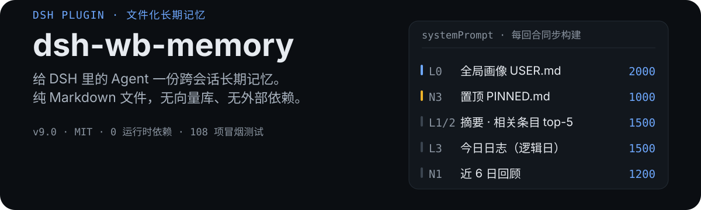

# dsh-wb-memory

<p align="center">
  
</p>

**给 DeepSeek Harness 的 Agent 一份跨会话长期记忆。** 真值源是各工作区的 Markdown 文件，无向量库、无第三方运行时依赖。每轮按预算注入画像、置顶、相关记忆和日志；后台小结、提炼与整理使用你指定的 LLM。

**当前版本：0.13.0** · Node.js 22+ · MIT · Windows + Node 24 已实测

[安装](#快速开始) · [记忆流水线](#自动化流水线) · [配置](#配置项) · [诊断](#状态与诊断) · [版本记录](#版本记录) · [测试](#开发与验收)

## 0.13.0：合成召回评测与跨层来源诊断

- 召回诊断区新增手动运行的26条固定合成语料评测：基线固定top-5，离线候选仅top-1/3/5，不读取真实记忆、不改线上配置。新增 `GET /api/wb-memory/recall-eval?candidateK=1`，沿用0.12.1逐请求Connection鉴权。
- 面板逐案展示漏选、禁选和额外未标注候选；“符合预期”要求期望全部命中、首选正确且无禁选/额外候选。额外未标注不等同错误事实；这比模块strict断言更严格，不能混报。
- 本轮基线22/26符合该面板口径，期望22/22命中；top-1对照24/26但期望仅20/22，说明减少噪声同时可能漏召回，不据此自动改top-K。数字区分、通用词及弱提及是待改善点。
- 跨层只读检查最终预算裁剪后的来源片段，整库仅作已替代/撤回条目的参照；不把未注入的current候选冒充注入来源。按章节标题启发式归属，重复/疑似数值冲突/退场事实仍被引用均是人工核实线索，不裁决事实、不屏蔽或改写日志。
- 实际账只保存来源与固定理由，单次最多20条；手动预览才返回各侧最多160字符（分析器当前60字符）的短证据，不落盘、不覆盖实际账。扫描上限、损坏元数据等降级均可见，无命中不保证没有冲突。
- 保持既有排序阈值、注入文本、模型、历史正文和0.12.1鉴权；八组冻结SHA验证组装文本不变。二十二套件通过，浏览器合成验收与真实HTTP分开；新增接口须重启后确认已注册及登录可用，不能以未知API的401充当证明。
- 运行标识：2026-10-17-v0.13.0。

## 0.12.1：修正命名路由鉴权绕过

- 0.12.0的安全结论已撤回：仅将exact路由迁到/api前缀不会继承Connection鉴权，重启后实测无登录仍返回200。
- 现在显式注入connection，并在每个实际处理器前调用官方connection.requestRejection(req)，复用宿主Host/Origin及浏览器/API凭据判断。缺方法、异常或非约定返回值一律503，绝不降级放行；无自定义Cookie校验、无认证缓存。
- 旧路由仍只410。十六套回归通过，注册接口拒绝分支与生命周期原用例均覆盖；真实运行认证仍须在重启后用已注册接口实测，不能用未知/api的401替代。运行标识：2026-10-17-v0.12.1。

## 0.12.0：记忆修订（鉴权错误已由0.12.1纠正）

- 实际接口使用 `/api/wb-memory/*`，但0.12.0未显式调用宿主认证，曾存在鉴权绕过；0.12.1补上独立准入。旧接口仅返回410，手动巡检改POST并校验同源；旧客户端需刷新。
- 「记忆文件」新增长期记忆管理：未编号条目先预览、确认后补随机稳定ID；平时查看不会写入或迁移。
- 显式更正保留旧正文并建立替代链；撤回不删除，恢复遇同链有效条目拒绝冲突。所有动作绑定全文revision，先备份再写入，过期409不自动覆盖。
- 默认长期召回、摘要与原生检索排除已替代/撤回条目；历史日志、置顶及画像不属于此生命周期，可能仍含旧信息。损坏管理元数据拒绝变更及长期召回，不静默重编号。
- 提炼拒绝生成保留管理标记；查重包含历史条目以减少旧事实复活。整理必须保留全部ID、状态与历史正文，仅可精简当前正文；不满足时保留原文件。
- 本批未自动迁移真实记忆、未改检索评分阈值、模型配置或提炼消费游标。运行标识：2026-10-17-v0.12.0。

## 0.11.0：面板与召回诊断

- 设置面板拆为「总览 / 召回诊断 / 记忆文件 / 自动化与治理」，复用 DSH 主题；保留现有配置、文件和危险操作确认。
- 实际组装与手动预览分开：展示候选数、筛选原因、排序分/相对分、字符预算和标题片段是否仍在最终文本。排序入选 ≠ 完整注入 ≠ 模型采用；相对分不是概率。
- 实际诊断仅保留每工作区最近一次，最多16个工作区、每次100个候选，不保存原始查询、条目正文或会话ID；进程重启/插件卸载后清空。标题仍是记忆内容，访问边界沿用现有面板。
- `POST /api/wb-memory/recall-preview` 复用现有同源校验，必须传已知 `workspace` 与1–4000字符的 `q`。只读、不同步写配置、不调用模型、不更新热度，也不覆盖实际组装记录；不是新鉴权框架。
- 本批不改变检索排序/阈值、提炼模型与游标、写入保护或自动治理策略。版本运行标识：`2026-10-17-v0.11.0`。

## 主要能力

- **可读、可备份**：每个工作区独立保存长期记忆、置顶和每日日志；全局画像由候选机制维护。
- **按当前任务召回**：长期条目使用连续中文 bigram、中英停用词和 IDF 字段评分，首轮用户任务也能参与检索；摘要与相关条目二选一。
- **小结防丢**：完成轮次闲置后生成小结；本地快照支持重启恢复、失败重试及输入版本去重，继续聊天可以生成新版本。
- **分块增量提炼**：当天及历史日志共用消费游标、前缀指纹与批次回执；追加续跑，失败不推进，残缺输出不入库。
- **公平调度**：跨工作区、日期轮转；失败持久退避，不让前排反复失败耗尽全部额度。
- **安全整理**：保留结构化写入护栏、备份与并发检查；仅整理允许合并完整尾部新条目，不自动置顶或按热度归档。
- **设置面板与原生工具**：管理记忆、配置模型、治理文件，并用 `memory_search` 同时检索长期条目与近期日志。

## 快速开始

在 DSH profile 中安装并加入 bundle，例如本地开发链接：

```json
{
  "dependencies": {
    "dsh-wb-memory": "link:C:/Users/<你>/.dsh/plugins-dev/dsh-wb-memory"
  },
  "dsh": {
    "profile": {
      "bundles": ["@deepseek-ai/dsh-base", "@deepseek-ai/dsh-web-app", "dsh-wb-memory"]
    }
  }
}
```

插件通过 [cordis.patch.yml](./cordis.patch.yml) 加入 profile 层栈。**安装或更新后台源码后，完全退出并重启 DSH 宿主，刷新浏览器不够。** 在设置面板找到 wb-memory，并检查总开关。

1. 指定工作区根：环境变量 `DSH_WORKSPACE_ROOT` 优先于 `workspaceRoot`。未指定时仅兼容已存在的旧 Windows 根 `D:/datas/Deepseek Harness`，不猜测用户目录；其他平台应显式配置绝对路径。
2. 会话 cwd 位于该根的某工作区内时自动匹配，否则用面板选择的 `activeProject` 兜底。
3. 在面板选择提炼模型；整理模型可独立选择，未指定时沿用提炼路由。路由不可用不会静默切到主 Agent 模型。
4. 用只读 `GET /api/wb-memory/status` 核对 `runtimeRevision=2026-10-17-v0.11.0`。

[config.example.json](./config.example.json) 提供无机器路径、无个人模型选择的示例。可在**尚无本机配置时**复制成插件目录的配置文件，再填写根目录及路由；不要覆盖已在用的配置。示例关闭了 `autoDistill` 和 `sessionSummary`，选好模型后自行开启，避免无意触发后台费用。程序缺字段仍使用内置默认值，不等同示例开关。

本机配置、个人画像、消费游标与运行状态均不提交 Git。本版停止跟踪旧版的本机配置；**从仍跟踪配置的旧提交升级前，先备份插件目录配置，升级后恢复**，避免 Git 删除旧的受跟踪文件。本次本地发布已保留现用配置，仅从 Git 索引移除。

## 上下文注入

同步拼装、只读，不在注入路径调用 LLM 或写状态：

| 层 | 内容 | 默认字符预算 |
| --- | --- | --- |
| 全局画像 | 插件目录画像 | 2000 |
| 用户置顶 | 工作区置顶，必须由用户明确要求 | 1000 |
| 长期摘要 | 条目标题与首行，无相关召回时使用 | 1500 |
| 长期相关条目 | 当前任务 top-K，与摘要互斥 | 每条基础800，动态最多2000 |
| 今日日志 | 保留尾部最新记录 | 1500 |
| 近日日志回顾 | 零 LLM，默认近6日 | 1200 |

总预算 `injectionMaxChars` 默认12000、下限4000，包含包装与纪律。动态余量按相关评分分配，短条目的空余额可复用；画像与置顶优先。**这是字符上限，不是精确 token 限制**，小预算可能裁掉相关正文。长期摘要不含全文，相关条目也有截断；完整内容可用文件工具或 `memory_search` 按需读取。

热度仅记录曝光次数和最近曝光时间，同会话轮次去重、异步刷盘；不参与检索评分、不自动归档或置顶。同名标题合并计数，重命名视新条目，未刷盘的最后几秒计数可能丢失。

## 记忆存储

```text
<工作区>/.workbuddy/memory/
├── MEMORY.md              # 长期条目：元数据注释 + ## 标题 + 正文
├── YYYY-MM-DD.md          # 每日日志：自动流水、会话小结及人工记录
├── PINNED.md              # 用户明确置顶，不参与整理和治理
├── summary-pending.json   # 含会话片段的恢复快照；应按私密数据保护
├── heat.json              # 曝光统计
├── archive/               # 过期日志及长期记忆备份
└── .trash/<时间戳>/        # 可恢复的回收文件

<插件目录>/
├── USER.md                # 全局画像，Agent只读
├── USER-CANDIDATES.md     # 画像候选，由巡检评估合并
├── config.json            # 本机配置
├── distilled.json         # 消费游标、指纹、回执及整理标记
├── distill-schedule.json  # 跨工作区/日期轮转及失败冷却
└── distill-diagnostics.json # 有界诊断，不是永久审计档案
```

文件属于本地敏感数据，尤其小结快照可能含聊天片段。诊断不保存输入/输出正文或任意错误原文，但会包含工作区名、路由名、长度、散列批次和时间。备份时请同时考虑数据隐私；本仓库只携带合成测试资料。

## 自动化流水线

### 1. 流水与会话小结

- **auto-digest（零 LLM）**：完成一轮后把“用户要求 → 结论”追加到逻辑日日志，带去重及每日上限；助手摘要保留头尾。
- **会话小结（LLM）**：完成轮次后默认闲置10分钟、累计用户文本至少300字符才生成，每逻辑日默认最多8次。输入用户总预算2000字符、助手最近两条各500字符；超长输入仍会裁剪，不保证无限聊天完整保留。
- live 定时器、60秒恢复扫描及失败重试共用完成态和闲置门禁；保存完成时间，新轮重置计时，重复落盘不刷新。旧快照缺时间字段时保守等待。原逻辑日和输入版本参与幂等判断，失败可恢复，同一版本已完成不再写入。
- 正常关闭浏览器不等于宿主退出；关机期间不会生成小结或提炼。快照防普通重启丢失，不是断电绝对持久保证。

### 2. 日志提炼（LLM）

默认每小时巡检，启动后约60秒首次尝试。当天仅处理完整行的稳定前缀，默认新增至少300字符且文件闲置2分钟；历史日志含归档目录也会处理。**2分钟是准入条件，不是2分钟必定入库。**

每块默认最多12000输入字符、2000输出 token，每轮默认最多8块；跨工作区和日期轮转。失败让出位置，不推进消费游标，同轮不反复调用该失败日期；持久退避为2/4/8/16/24小时封顶。公平调度降低饥饿风险，不保证固定入库时限。

消费标记含 UTF-16 offset、前缀 SHA256、批次回执；已处理前缀被改写或旧标记没有长度时保守重扫并查重，可能增加模型费用。当天完成后有新追加仍可续跑。提交后崩溃可用回执恢复，零新增不强制创建长期文件。

### 3. 整理与画像（LLM）

- 长期记忆超阈值后整理，写前备份。非空、变短和至少保留一半条目是结构护栏；压回目标阈值未达标可带警告接受，避免永远无法自愈。每工作区每日尝试限制及反馈重试由现有标记控制。
- Agent 不直接改全局画像：先追加候选，巡检评估合并。画像必须有一级标题和二级分区，并满足长度及不低于旧文30%等校验；失败保留候选。
- 生成协议同时放在 system 与数据之外的 user 消息中，兼容网关替换 system；历史数据使用转义 JSON 封装。输入更长会增加 token，不构成提示注入免疫保证。

### 4. 治理

按 TTL 归档过期日志，报告近重复但不自动合并，清理回收站与归档中的超期副本。置顶不参与。两个清理保留天数设为≤0可禁用对应清理；`gcEnabled=false` 跳过治理。

删除先 rename 到回收站；治理对超期副本会**真正删除**，不能把治理接口当状态轮询。原查重 tokenizer 和默认阈值0.45不随新检索评分变化。

## 写入护栏与限制

- 只接受完成态为正常结束的模型结果；截断、超时、缺 finish、空正文及非法结构拒收，不推进游标。
- 提炼每个非空条目都必须有闭合元数据注释、二级标题与正文；LF/CRLF、缩进及条目间空行合法，残缺中间或尾条整批拒收，不靠丢条伪装成功。
- `guardedWrite(p, content, expectedRaw)` 默认发现原文改变就拒写；只有整理显式允许合并“原快照未变 + 尾部完整新条目”。编辑旧正文或半条目仍拒绝，画像不启用追加合并。
- 正文及状态用临时文件加 rename 替换；这是**单宿主写者约束**，不是跨进程原子 CAS，也没有 fsync 断电保证。
- 面板人工确认覆盖属于显式写操作，与后台异步整理的冲突护栏不是一回事。
- 长期条目使用新 IDF 检索；日志搜索仍是原关键词匹配。共享词可能误召回，纯版本号等也可能漏日志，不能等同语义搜索。

## 状态与诊断

只读状态：`GET /api/wb-memory/status?workspace=<工作区>`。

- 顶层 `runtimeRevision` 用于确认宿主加载版本。
- `distill.pendingDates/lastAt` 只属于当前解析工作区，**不是全库积压数或全局最近巡检时间**。
- `diagnostics.scope=global` 是全库有界诊断，最多64个事件另留最近巡检起止摘要，覆盖逐块/模型完成与拒收类别。开始但无结束可能在运行或宿主退出，不足以直接断言失败。
- `model.finish=truncated` 才是截断证据；HTTP 200或恰好用完 token 本身不是。
- `block.status=committed` 表示块游标已提交；工作区待处理且剩余额度为0表示本轮未轮到，不应叫模型失败。
- `lastSweepEnd.attempted/failed/committed` 仅统计提炼块，partial也可能来自整理或画像失败。

| 路由 | 方法 | 用途 |
| --- | --- | --- |
| `/api/wb-memory/memories` | GET/POST | 生命周期列表/详情、迁移预览及显式修订；严格工作区、revision、备份及同源检查 |
| `/api/wb-memory/config` | GET/POST | 配置读写，POST字段白名单及同源检查 |
| `/api/wb-memory/status` | GET | 只读工作区状态与全库诊断 |
| `/api/wb-memory/recall-preview` | POST | 只读模拟召回，不记录实际账；同源校验、已知workspace与q长度校验 |
| `/api/wb-memory/workspaces` | GET | 工作区列表 |
| `/api/wb-memory/files` | GET | 记忆文件列表 |
| `/api/wb-memory/file` | GET/POST/DELETE | 读、人工覆盖或移入回收站 |
| `/api/wb-memory/search` | GET | 关键词检索，可指定工作区与日期 |
| `/api/wb-memory/gc` | POST | 手动治理，有真实清理副作用 |
| `/api/wb-memory/distill` | POST | **触发全工作区巡检**，含整理及画像候选；不是只读 |
| `/api/wb-memory/models` | GET | 已注册模型路由，不保证推理服务可用 |
| `/api/wb-memory/debug-cwd` | GET | 最近会话cwd与工作区解析 |

`memory_search` 参数：`q`，及可选 `workspace/date_from/date_to`，同时覆盖长期记忆与近日日志。修改工具开关 `memorySearchTool` 需重载插件，常规配置读取热生效；源码变更必须重启宿主。

## 配置项

| 分组 | 常用字段 |
| --- | --- |
| 根与开关 | `enabled activeProject workspaceRoot dayBoundaryHour` |
| 总预算与曝光 | `injectionMaxChars dynamicBudget memoryHeat` |
| 分层预算 | `profileMaxChars pinnedMaxChars summaryMaxChars entryMaxChars relevantTopK logMaxChars weekWindowDays weekMaxChars weekSummaryDailyChars` |
| 流水 | `autoDigest digestMaxPerDay digestUserChars digestAssistantChars` |
| 小结 | `sessionSummary summaryIdleMs summaryMinUserChars summaryMaxPerDay` |
| 模型与提炼 | `autoDistill distillProvider distillModel compactProvider compactModel compactMaxTokens compactRetryFeedback distillMaxInputChars distillMaxTokens distillTimeoutMs` |
| 调度与当天 | `distillIntervalMs distillStartDelayMs distillMaxBlocksPerSweep dailyDistill dailyDistillMinChars dailyDistillIdleMs` |
| 检索 | `memorySearchTool searchLogDays searchLogTopK` |
| 治理 | `gcEnabled logRetentionDays memoryCharThreshold dupThreshold trashRetentionDays archiveRetentionDays` |

逻辑日默认凌晨4点分界，凌晨3点仍算前一天。配置支持UTF-8 BOM；坏 JSON 会备份再重建。模型路由要选择当前宿主可用的 provider/model，注册存在不等于外部网关在线或请求成功。

## 版本记录

历史内部编号 **9.0.0重置为0.10.0**，不是SemVer递增，包管理器不会自动视为升级，请显式更新到新版本或本地链接。以后采用**大.中.小**：1.0.0重大/不兼容、0.11.0新增功能、0.10.1修复。

| 版本 | 变化 |
| --- | --- |
| **0.12.0** | 宿主保护API、旧接口410、POST巡检；稳定ID与显式更正/撤回/恢复、修订历史和整理保护 |
| 0.11.0 | 四分区主题面板、实际组装与手动预览诊断、旁路原因及字符预算；不改检索策略 |
| 0.10.5 | 修复条目间跨行空白误拆空条目，保留残缺输出整批拒收 |
| 0.10.4 | 提炼、整理及反馈重试、画像、小结共用user任务协议冗余入口 |
| 0.10.3 | 工作区/日期公平轮转、持久失败退避；仅在能力明确公告时请求low思考档，不换模型 |
| 0.10.2 | 有界巡检、逐块和模型诊断，状态口径区分工作区与全库 |
| 0.10.1 | 修复恢复扫描提前小结和用户输入300字截尾；共用闲置门禁 |
| 0.10.0 | 独立IDF检索、持久小结、分块游标、安全追加合并、总预算、根配置与曝光统计 |

## 开发与验收

```bash
node --check lib/index.js
node --check lib/client.js
npm test                       # 十五个隔离套件，假模型，无真实LLM调用
node test/perf-v010.mjs         # 可选：合成集检索性能对照
```

测试覆盖原135项护栏冒烟、首轮召回、完成态/残缺输出拒收、IDF效果、预算与只读注入、分块/崩溃回执恢复、并发上限、小结门禁、诊断、调度退避、网关替换system及解析器；面板/路由套件105项覆盖召回逐值等价、诊断字段白名单、工作区隔离、迁移备份/修订、旧接口410与写方法/同源拒绝；生命周期16项覆盖CRLF、元数据/关联异常、并发拒绝和真实整理入口保护。公开消息夹具为合成数据，不携带个人存档。小合成集的检索效果和性能不能当成真实库普遍收益。

**2026-10-16真实端到端验收（0.10.5）：** 在隔离工作区验证了完整用户输入→闲置小结→自然提炼→长期入库→新会话首轮自动注入及无工具正确回答→同日志追加续跑。追加消费位置从950推进到1646，仅处理新增696字符；旧前缀SHA匹配、旧条目保留、新条目与批次回执各一份。

首轮注入同时含日志回顾，不能证明模型只依赖长期记忆；本次样本通过不代表未来网关、模型或每轮调用都可靠。真实验收资料含本地会话信息，不随仓库发布。测试工作区与会话已由用户清理。

[import-wb-memory.mjs](./import-wb-memory.mjs) 是面向旧存储的一次性遗留脚本，当前流水线不依赖它，运行前应自行核对路径。

## License

[MIT](./LICENSE)
